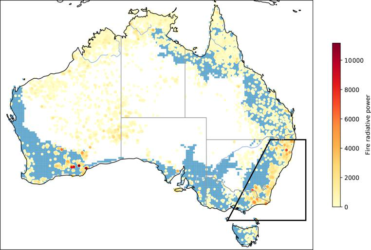
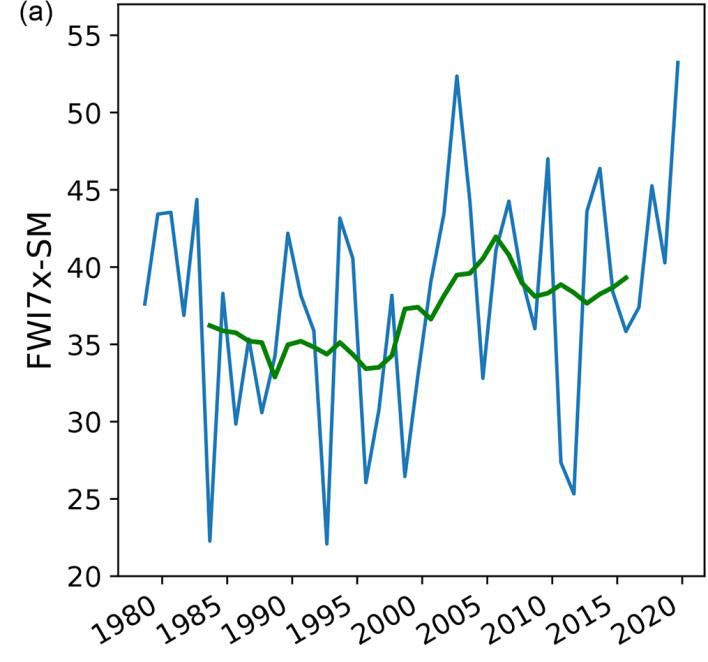

<a href="https://www.australia.com/en" target="_blank" rel="noopener" class="external-tag">Australia</a>
<a href="https://www.climatechangeinaustralia.gov.au/en/" target="_blank" rel="noopener" class="external-tag">Climate</a>
<a href="https://www.ga.gov.au/education/natural-hazards/bushfire" target="_blank" rel="noopener" class="external-tag">Bushfires</a>

In summer 2019-20, around 19 million hectares burned, 33 people died directly in the fires, almost 6,000 buildings were lost and smoke sat over cities for weeks. It was Australia's hottest and driest year on record.

The question that followed was simple: did human-caused climate change make a season like that more likely?

That’s what a team led by van Oldenborgh set out to test. This post is a plain-English summary of their peer-reviewed attribution study.

## The problem: what can we actually link to climate change?

A bushfire needs three things to happen: weather that makes fire spread fast, fuel to burn, and something to light it.

Human-caused climate change doesn’t light the match. It mostly changes the first one — the weather. The useful question isn’t “did climate change cause this fire?”, it’s “has dangerous fire weather become more likely?”

That’s what the study focused on, for forested south-east Australia — the box you can see in @fig-map.

{#fig-map width=85%}

Before they started, they checked that their measure of fire weather actually matters. It does. The measure they used is the Fire Weather Index (FWI). It’s a daily score built from temperature, humidity, wind and recent rain. When FWI is high, fires are harder to put out and burn more land. Think of it as a danger thermometer.

## Analysis: what the researchers did and found

**Where the evidence comes from**

The study is van Oldenborgh et al. (2021) in *Natural Hazards and Earth System Sciences*. For what really happened, they used the ECMWF ERA5 reanalysis — a reconstruction of past weather from 1979 to January 2020 — and NASA’s satellite fire record. For global warming, they used NASA's GISTEMP. To separate a world with and without human emissions, they used 11 different climate models.

**What changed**

@fig-fwi shows the worst fire weather of each season in the south-east from 1980 to 2020. Any single year jumps around, but the 10-year average — the smooth green line — keeps climbing. 2019-20 sits at the very top. It was the most extreme in that 40-year record.

{#fig-fwi width=90%}

To turn that trend into a number, they fitted a statistical curve to extremes and let it shift as the planet warms. Then they read off the odds today versus around 1900.

@tbl-risk sums it up in plain language.

| What was measured | What it means in real life | How much more likely is it now? | How sure are we? |
|---|---|---|---|
| Fire Weather Index - worst 7 days | Day-to-day danger from heat, wind and dryness | At least 30% more likely in models; 4x or more in direct observations | Solid lower bound - true rise likely larger |
| Monthly Severity Rating | How hard fires are to put out over a whole month | About 9x more likely in observations; 2x in models | Likely increase, wide range |
| Extreme heat - hottest 7 days of fire season | The heat that drives the danger | At least 2x more likely | Pretty robust |
| Rainfall deficit | How much rain was missing | No clear human-caused trend found | No signal |
| Future at +2°C warming | What happens if warming continues | About 4x more likely than 1900 | From models |

: How human-caused climate change has changed the odds of a Black Summer-type season in south-east Australia, compared to ~1900. Based on van Oldenborgh et al. (2021). {#tbl-risk}

As you can see in @tbl-risk, the heat part is clearly on us. A hot spell like December 2019 is at least twice as likely because of human-caused warming. 

The missing rain is different. That year’s record-low rain was mostly natural bad luck — a record swing in the Indian Ocean Dipole and an unusual Southern Annular Mode — that lined up badly. Climate change sharpened the heat and fire weather, but not the drought itself.

One important caveat the authors flag, and it matters for how you read the numbers: the models are a bit too cool on this trend. They wobble year-to-year and underestimate the long-term rise in both heat and fire weather. That’s why they give their results as “at least 30%” — they mean it as a floor, not their best guess. The real rise is probably bigger, we just can’t pin down exactly how much bigger.

So does this answer the question we started with? Yes — the dangerous weather that makes a Black Summer possible is now significantly more likely, and it’s mostly driven by the hotter temperatures we’ve added.

## Conclusion: what this means for the next Black Summer

Black Summer felt unprecedented because, for fire weather, it was. Since around 1900, the chance of that level of fire weather in south-east Australia has risen by at least 30% in climate models and by four times or more when we look directly at what we’ve observed. That lower-bound nature is key — 30% is the minimum we can defend, not the ceiling.

At 2°C of global warming — a world we are heading towards — the same study projects that kind of fire weather becomes about four times more likely again compared to 1900 [van Oldenborgh et al., 2021].

There was no clear human fingerprint on the rainfall failure that year. But the heat and the fire danger that turned dry fuel into an uncontrollable season do carry one, and the trend in @fig-fwi is still climbing.

If you live, work, or plan for fire risk in south-east Australia, it makes sense to start from a rising baseline. This paper gives us a credible floor to plan from.

> **Reference:** van Oldenborgh, G.J., Krikken, F., Lewis, S., et al. (2021). Attribution of the Australian bushfire risk to anthropogenic climate change. *Natural Hazards and Earth System Sciences*, 21, 941–960.
